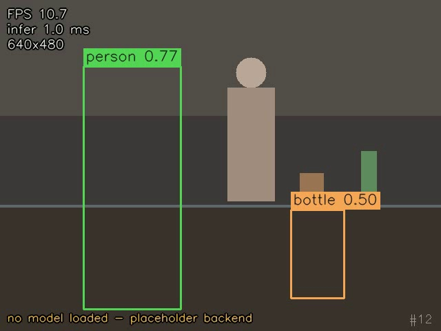

# 树莓派实验室实时检测

在树莓派 4 上跑 YOLOv5-Lite，接摄像头直接出画面，检测框画上去之后从 HDMI 输出，整个过程在板子上完成，不连电脑。用途是看实验室里有没有人在工位、桌上的设备有没有被用着。

项目结构和上一份循迹小车的仓库保持一致：代码在 `src/`，配置单独放 `configs/`，跑出来的东西进 `outputs/`。

> **当前状态：数据集和模型都是空的。** 代码能跑，但检测结果是空的——不是程序有问题，是还没有权重文件。
> 加载不到模型时会自动切到占位后端（不推理、不报错），链路照样走完。要走真实检测，按
> [models/README.md](models/README.md) 放权重，按 [data/README.md](data/README.md) 放数据。



上面这张是合成画面加占位模型输出的截图，用来看渲染和 HUD 有没有问题，**不是真实检测结果**。

## 硬件与环境

- 树莓派 4B（2G 内存以上），Raspberry Pi OS Bookworm 64 位
- 摄像头：CSI 摄像头走 picamera2，USB 摄像头走 opencv，两个都支持
- 显示：HDMI 直连，或者不开窗口直接存 mp4
- Python 3.9 以上，依赖见 `requirements.txt`

装依赖：

```bash
sudo apt update
sudo apt install -y python3-opencv python3-picamera2   # 树莓派上这两个用系统包更省事
pip install -r requirements.txt
```

picamera2 只有树莓派系统里有，装在别的机器上会失败，脚本里是懒加载的，import 不到就换别的视频源，不影响其他功能。

## 目录

```
src/
├── main.py         入口，参数解析、启动、统计
├── pipeline.py     采集线程 + 推理循环
├── camera.py       三种视频源：picamera2 / opencv / synthetic
├── detector.py     预处理、推理、后处理，三个后端：onnx / ncnn / mock
├── dataset.py      数据集读取，目前数据为空
└── utils/
    ├── config.py       配置加载，相对路径统一按项目根目录算
    ├── postprocess.py  letterbox、框解码、NMS
    ├── draw.py         画框、画 HUD
    └── fps.py          帧率和耗时统计
configs/detect.json   所有可调的东西都在这里
data/                 数据集目录，空，格式见 data/README.md
models/               模型目录，只有 classes.txt，见 models/README.md
scripts/check_env.py  环境自检
tests/smoke_test.py   冒烟测试，不需要真模型和真数据
assets/               截图
outputs/              结果视频、日志，不进 Git
```

## 装上就能跑

没摄像头、没模型也能跑，会用合成画面和占位后端：

```bash
python src/main.py --source demo --max-frames 60
```

接上摄像头跑实时：

```bash
python src/main.py --display              # 自动找 CSI 摄像头，找不到就用 USB
python src/main.py --source 0 --display   # 指定 USB 摄像头编号
```

处理一段录好的视频，不开窗口，存结果：

```bash
python src/main.py --source lab.mp4 --save-video
```

跑完会打印一段统计（下面是格式示例，数字不是实测值，具体跑出来多少看板子）：

```
运行统计
  处理帧数        600
  采集帧数        612
  未处理帧数      12（达到上限或退出时队列里还剩）
  平均帧率        11.3 fps
  平均推理耗时    68.4 ms
  检测框总数      1534
  类别分布        person x820, laptop x402, cup x210, chair x102
  结果视频        .../outputs/result.mp4
```

`平均推理耗时` 只算模型前后向，不含采集和画图；`平均帧率` 是整条链路实际跑出来的。这两个数对不上是正常的，差得越多说明瓶颈越不在推理上。

## 检测链路

采集和推理分成两个线程，中间只传一帧：

```
采集线程 ──► 最新帧（或队列）──► 推理循环 ──► 画框 ──► HDMI / mp4
```

用的是"只留最新帧"的做法。树莓派上推理比采集慢，如果在一个循环里顺序读图、推理，摄像头缓冲区会一直堆，画面越来越延迟，越跑越像慢动作。拆开之后，推理慢就丢采集帧，画面始终是当前的，代价是帧率跟着推理速度走。

两种模式按输入自动切换：

- 摄像头：丢帧，保持低延迟（`runtime.drop_late_frames = true`）
- 视频文件：排队逐帧处理，一帧不丢，否则 30 帧的短片可能只处理到一两帧

## 一次推理做了什么

1. **采集**：picamera2 拿 `RGB888` 数组，转成 BGR 和 opencv 对齐；opencv 后端直接读
2. **letterbox**：等比缩到 320×320，空的地方补灰（114），记下缩放比例和补边量
3. **预处理**：BGR→RGB，除以 255，HWC→CHW，加 batch 维
4. **推理**：onnxruntime 或 ncnn 跑一次
5. **解码**：取 `obj × 类别分`，卡阈值，`cxcywh` 转 `xyxy`，减补边除以比例，回到原图坐标
6. **NMS**：按类别分开做，重叠的框只留分高的
7. **画图**：框、类别名、分数，左上角叠 FPS 和推理耗时

坐标换算这一步最容易错，`tests/smoke_test.py` 里专门用手算过的例子卡住了：640×480 的图缩到 320×320 之后，一个中心在画面正中、宽 0.3 高 0.6 的归一化框，还原回来必须是 `(224, 16, 416, 400)`。

## 配置

改 `configs/detect.json`，或者用命令行参数临时覆盖（`--source`、`--camera-backend`、`--model-backend`、`--max-frames`、`--display`、`--save-video`）。

| 字段 | 作用 |
| --- | --- |
| `paths.model` | 权重路径，相对项目根目录 |
| `paths.classes` | 类别名文件 |
| `paths.dataset_root` | 数据集根目录，默认 `data` |
| `paths.output_dir` | 输出目录 |
| `camera.backend` | `auto` / `picamera2` / `opencv` / `synthetic` |
| `camera.source` | 摄像头编号或视频文件 |
| `camera.width` `height` `fps` | 采集参数，改小能省带宽 |
| `model.backend` | `auto` / `onnx` / `ncnn` / `mock` |
| `model.input_size` | 模型输入尺寸，必须和导出时一致 |
| `model.conf_threshold` | 置信度阈值，实验室场景 0.35 左右够用 |
| `model.iou_threshold` | NMS 的 IoU 阈值 |
| `runtime.display` | 是否弹窗显示 |
| `runtime.save_video` | 是否存 mp4 |
| `runtime.drop_late_frames` | 丢旧帧，实时用 true；设 false 就是逐帧处理 |

## 性能与调参

树莓派 4 的算力摆在那，能调的其实就几个旋钮：

- **输入尺寸**：320 一档、416 一档，往上收益递减。320 跑不动的话先降到 256，精度掉得比帧率涨得少
- **模型大小**：YOLOv5-Lite 的 s / m / l 三档依次变慢，板子上一般只考虑 s
- **后端**：ncnn 比 onnxruntime 快，代价是要自己编包，先用 onnx 跑通再换
- **采集分辨率**：和推理尺寸解耦，采集 640×480 缩到 320 反而比直接采集 320 准，因为 letterbox 的缩放比例更接近整数
- **画图开关**：`--no-draw` 能省掉每帧的绘制时间，压测推理上限时用

具体能跑多少帧跟模型、参数、供电、散热都有关系，别信别人报的数。自己用 `--max-frames 200` 跑一遍，看统计里的"平均推理耗时"，那个数是这块板子上的真实情况。

## 数据集和模型

两个都是空的，目录和接口已经搭好：

- `data/` 下面只有 `images/` 和 `labels/` 两个空目录加说明文档，**待补充**。格式是 YOLO 标注（`class_id cx cy w h`，归一化），放进去就能读，代码不用改
- `models/` 下面只有 `classes.txt`，**待补充**权重。输出格式要求、导出命令、ncnn 转换都写在 `models/README.md`

空数据集不会让程序报错：`len(dataset)` 是 0，`sample.labels` 是 `(0, 5)` 的空数组，下游取 `shape` 不会炸。想看看一条样本长什么样：

```bash
python src/main.py --dataset-demo
```

## 自检和测试

第一次上板前：

```bash
python scripts/check_env.py
```

会逐个报 numpy、opencv、picamera2、onnxruntime、ncnn 有没有，模型和数据在哪、有没有缺。

改过代码之后：

```bash
python tests/smoke_test.py
```

30 项检查，覆盖 letterbox 换算、NMS、输出解码、空数据集行为、标注读写、占位后端、整条流水线跑完。不需要真模型和真数据，在电脑上也能跑。

数据准备好了之后：

```bash
python src/main.py --check-dataset
```

## 关于这份仓库

模型权重、数据集、训练用的图片都没上传，仓库里只有代码、目录约定和说明文档。这两样东西体积大、也没法公开，需要的话按上面两个 README 自己补。

`assets/demo_frame.jpg` 是在电脑上跑 `--source demo --fake-detections` 截的，画面是代码画的合成场景，框是占位后端返回的假框，只用来确认渲染没画错位置。
